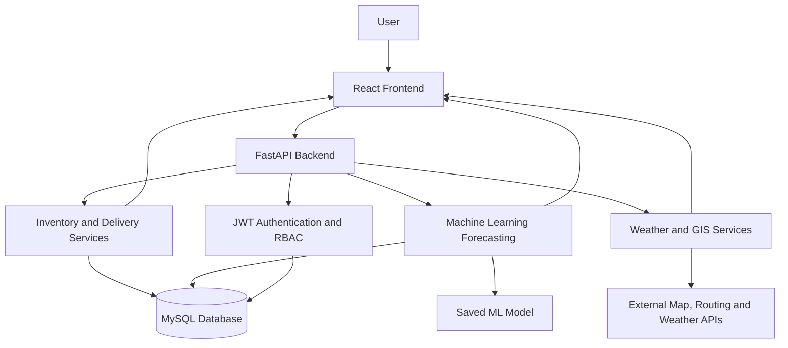

# 🛡️ Indian Army – Predictive Logistics & Forward Supply Chain

**Problem Statement ID:** 26251 (Software)  
**Domain:** Artificial Intelligence, Machine Learning, GIS & Inventory Management  
**Project Type:** Decision-Support Web Application

**Predictive Logistics & Forward Supply Chain** is an AI/ML-powered web application designed to improve inventory management, demand forecasting, shortage detection, weather risk assessment, and supply chain visibility through a centralized decision-support dashboard.

> [!IMPORTANT]
> **Disclaimer:** This project uses 100% fictional and synthetic data for educational, demonstration, and software development purposes. All locations, coordinates, supply centres, routes, inventory records, and operational scenarios are fictional. No real military deployment locations, operational routes, or confidential information are included.

---

## 📑 Table of Contents

- [Project Overview](#-project-overview)
- [Objectives](#-project-objectives)
- [Key Features](#-key-features)
- [System Modules](#-system-modules)
- [Machine Learning Pipeline](#-machine-learning-pipeline)
- [GIS and Route Planning](#-gis-and-route-planning)
- [Weather Risk Analysis](#-weather-risk-analysis)
- [Technology Stack](#-technology-stack)
- [System Architecture](#-system-architecture)
- [Database Schema](#-database-schema)
- [API Documentation](#-api-documentation)
- [Project Structure](#-project-structure)
- [Prerequisites](#-prerequisites)
- [Installation and Setup](#-installation-and-setup)
- [Environment Configuration](#-environment-configuration)
- [Running the Application](#-running-the-application)
- [Machine Learning Model Training](#-machine-learning-model-training)
- [Security](#-security)
- [Future Enhancements](#-future-enhancements)
- [Troubleshooting](#-troubleshooting)
- [References](#-references)
- [License](#-license)

---

## 📖 Project Overview

Managing inventory and supply chains in remote and high-altitude environments presents challenges related to uncertain demand, transportation delays, weather conditions, and unexpected shortages.

Traditional inventory management systems often respond to shortages after they occur. This project introduces a **predictive, data-driven approach** that estimates future demand, identifies potential stock shortages, and provides recommendations for inventory replenishment.

The application combines machine learning, geospatial visualization, weather analysis, and inventory management in a single web-based platform.

### Problem Statement

How can AI/ML, GIS, and inventory management technologies be combined to forecast future supply requirements, identify potential shortages, assess transportation delays, and support informed logistics decisions?

### Proposed Solution

The system provides a centralized dashboard that enables authorized users to:

- Monitor inventory levels across fictional supply centres.
- Forecast future consumption using machine learning.
- Identify low-stock and at-risk inventory items.
- Calculate days of stock coverage and suggested reorder quantities.
- Assess weather-related transportation delay risks.
- Visualize fictional supply centres and road routes on interactive maps.
- Track deliveries and maintain inventory transaction records.
- Manage access through role-based authentication.

---

## 🎯 Project Objectives

1. Develop an intelligent inventory management platform.
2. Forecast future demand using a Random Forest regression model.
3. Identify potential shortages before inventory reaches critical levels.
4. Calculate recommended replenishment quantities using demand, lead time, and safety stock.
5. Visualize fictional supply networks through GIS-based maps.
6. Analyze weather conditions and estimate potential transportation delays.
7. Track deliveries and maintain an auditable transaction history.
8. Provide secure access to dashboards and management features.
9. Evaluate forecasting performance using MAE and RMSE.
10. Demonstrate an end-to-end AI-powered decision-support workflow using synthetic data.

---

## 🚀 Key Features

| Feature | Description |
|---|---|
| Authentication | JWT-based login and API authentication |
| Role-Based Access | ADMIN, COMMANDER, OPERATOR, and VIEWER roles |
| Command Dashboard | Inventory KPIs, risk summaries, and recent activities |
| Inventory Management | Create, view, update, and manage supply item records |
| Stock Transactions | Record stock-in and stock-out operations |
| Demand Forecasting | Predict demand for the next 7 or 30 days |
| Shortage Detection | Identify inventory items at risk of running out |
| Replenishment Engine | Calculate suggested reorder quantities |
| Weather Analysis | Assess simulated or API-based weather risks |
| GIS Mapping | Display fictional centres using interactive maps |
| Route Visualization | Display primary and alternative route geometries |
| Delivery Tracking | Monitor delivery status and progress |
| Model Evaluation | Display forecasting MAE and RMSE metrics |
| Audit History | Maintain records of stock transactions |

---

## 🧩 System Modules

### 1. Authentication and Access Management

The system uses JSON Web Tokens (JWT) to authenticate users and protect API endpoints.

**Supported roles:**

| Role | Permissions |
|---|---|
| `ADMIN` | Full system access, including user management |
| `COMMANDER` | View reports, monitor risks, and approve supported workflows |
| `OPERATOR` | Manage inventory, record stock movements, and update deliveries |
| `VIEWER` | Read-only access to dashboards and reports |

Authorization rules are enforced by the backend rather than relying solely on frontend visibility.

### 2. Command Dashboard

The dashboard presents a consolidated overview of the application's current state.

**Key indicators:**

- Total inventory records.
- Low-stock inventory items.
- At-risk fictional supply centres.
- Pending and delayed deliveries.
- Inventory distribution by category.
- Recent inventory and delivery activities.
- Active forecasting model and evaluation metrics.

**Visualizations:**

- Pie charts for inventory risk distribution.
- Bar charts for inventory categories.
- Timeline views for recent activities.
- Inventory health indicators based on safety-stock thresholds.

### 3. Inventory Management

The inventory module manages supply item records and stock balances across fictional supply centres.

**Supported operations:**

- Create and update supply items.
- View inventory balances.
- Record stock-in and stock-out transactions.
- Configure safety-stock thresholds.
- View stock health and shortage indicators.
- Maintain transaction history.

**Inventory validation:**

- Stock-out operations must not produce negative inventory.
- Each accepted transaction should be recorded in the stock ledger.
- Inventory updates and corresponding transaction records should be handled atomically.
- Unauthorized users must not perform restricted operations.

### 4. AI/ML Demand Forecasting

The forecasting module uses a `RandomForestRegressor` to predict future daily consumption.

**Forecast horizons:**

- 7-day demand forecast.
- 30-day demand forecast.

**Model features:**

- `day_of_week`
- `month`
- `lag_1`
- `lag_7`
- `lag_14`
- `roll_mean_7`
- `roll_mean_14`

The model is trained on synthetic historical consumption data. A chronological train/test split is used to evaluate performance on later observations.

Forecast results can be displayed with prediction values and an uncertainty estimate based on historical model errors.

> **Note:** An RMSE-based interval is an approximate uncertainty band, not automatically a statistically calibrated confidence interval.

### 5. Shortage Alerts and Replenishment

The shortage analysis module estimates inventory risk using current stock, demand, safety stock, and replenishment lead time.

**Days of Cover:**

\[
\text{Days of Cover} =
\frac{\text{Current Stock}}{\text{Average Daily Demand}}
\]

When average daily demand is zero, the application should handle the calculation separately to avoid division-by-zero errors.

**Risk categories:**

| Risk Level | Illustrative Risk Score |
|---|---:|
| LOW | 0–24 |
| MEDIUM | 25–44 |
| HIGH | 45–69 |
| CRITICAL | 70–100 |

The shortage engine can suggest reorder quantities using the following general formula:

\[
Q = \max(0, D \times L + S - I)
\]

Where:

- \(Q\) = Suggested reorder quantity.
- \(D\) = Forecast average daily demand.
- \(L\) = Replenishment lead time in days.
- \(S\) = Safety-stock quantity.
- \(I\) = Current usable inventory.

The final implementation should also account for outstanding orders, incoming deliveries, and any applicable inventory policies.

### 6. Weather and Delay Risk Analysis

The weather module retrieves weather information from OpenWeatherMap when configured. An offline simulated fallback supports demonstrations without an API key.

**Weather factors:**

- Rainfall and precipitation.
- Snow conditions, when available.
- Wind speed.
- Visibility.
- Temperature extremes.

The module produces a delay-risk score between 0 and 100 and maps it to the configured risk categories.

Example recommendations include:

- Monitor weather conditions.
- Review estimated delivery delays.
- Reassess delivery schedules.
- Consider postponing a demonstration dispatch when simulated conditions indicate elevated risk.

All weather-based recommendations are decision-support suggestions and should not be treated as guarantees of actual travel conditions.

### 7. GIS Mapping and Route Visualization

The mapping module visualizes fictional supply centres and transportation connections.

**Map layers:**

- OpenStreetMap street layer.
- Esri satellite imagery.
- OpenTopoMap terrain layer.

**Routing components:**

- Fictional source and destination selection.
- Route geometry retrieval through the OSRM public demonstration service.
- Primary and alternative route visualization.
- Dynamic addition and removal of fictional map points.
- Geospatial distance calculations using the Haversine formula.
- Dijkstra's algorithm for shortest-path calculations on the application's configured graph.

The backend graph connects each fictional centre to its nearest neighbours. Route optimization and actual road routing are separate operations: a graph-based shortest path does not guarantee the fastest real-world road route.

> **Demonstration limitation:** Public routing and map services may have usage restrictions, availability limitations, or geographic coverage differences. Only fictional coordinates should be used for this project.

### 8. Delivery Tracking System

The delivery module tracks incoming shipments through defined lifecycle states.

**Delivery statuses:**

`PENDING` → `IN_TRANSIT` → `DELIVERED`

An additional `DELAYED` status may be used when a shipment encounters a delay.

**Key capabilities:**

- List incoming deliveries.
- View shipment status.
- Update delivery progress.
- Display a shipment timeline.
- Record delivery completion.
- Update inventory when goods are received.

**Inventory consistency:** Delivery completion and inventory updates should occur in a single database transaction. Repeated delivery-completion requests must not add the same quantity to inventory more than once.

---

## 🧠 Machine Learning Pipeline

### Data Generation

The project generates approximately 365 days of synthetic consumption history for each configured item and fictional supply-centre combination.

Synthetic records may include daily consumption patterns, trends, and controlled variations to support model development.

### Feature Engineering

| Feature | Purpose |
|---|---|
| `day_of_week` | Represents weekly demand patterns |
| `month` | Represents seasonal or monthly variation |
| `lag_1` | Consumption on the previous day |
| `lag_7` | Consumption seven days earlier |
| `lag_14` | Consumption fourteen days earlier |
| `roll_mean_7` | Mean consumption over the previous seven days |
| `roll_mean_14` | Mean consumption over the previous fourteen days |

Rolling statistics must use historical observations only. Features should be shifted appropriately to avoid including the target day's consumption.

### Model Training

The training pipeline follows these steps:

1. Load synthetic consumption history.
2. Sort records chronologically.
3. Generate lag and rolling-window features.
4. Split the dataset chronologically.
5. Train a Random Forest regression model.
6. Compare results with Linear Regression and a naive baseline.
7. Evaluate predictions using MAE and RMSE.
8. Save the selected model as `demand_model.joblib`.

### Model Evaluation Metrics

**Mean Absolute Error (MAE)**

\[
MAE = \frac{1}{n}\sum_{i=1}^{n}|y_i-\hat{y}_i|
\]

**Root Mean Squared Error (RMSE)**

\[
RMSE = \sqrt{\frac{1}{n}\sum_{i=1}^{n}(y_i-\hat{y}_i)^2}
\]

Where:

- \(y_i\) represents actual demand.
- \(\hat{y}_i\) represents predicted demand.
- \(n\) represents the number of evaluated observations.

Lower MAE and RMSE values generally indicate smaller prediction errors on the evaluated dataset.

### Forecast Inference

The application supports recursive forecasting:

1. Load recent historical consumption.
2. Generate features for the next day.
3. Predict demand.
4. Append the prediction to the working history.
5. Generate features for the following day.
6. Repeat until the requested forecast horizon is reached.

Recursive predictions can accumulate errors over longer horizons, so evaluation should reflect the same forecasting approach used in production.

---

## 🗺️ GIS and Route Planning

The GIS subsystem combines geospatial calculations with map-based route visualization.

### Haversine Distance

The Haversine formula estimates the great-circle distance between two geographic coordinates.

\[
a = \sin^2\left(\frac{\Delta\phi}{2}\right)
+ \cos(\phi_1)\cos(\phi_2)
\sin^2\left(\frac{\Delta\lambda}{2}\right)
\]

\[
d = 2R\arcsin(\sqrt{a})
\]

Where:

- \(\phi_1,\phi_2\) are latitudes in radians.
- \(\Delta\phi\) is the latitude difference.
- \(\Delta\lambda\) is the longitude difference.
- \(R\) is the Earth's mean radius.
- \(d\) is the estimated surface distance.

### Dijkstra's Algorithm

Dijkstra's algorithm calculates the lowest-cost path in a weighted graph with non-negative edge weights.

In this demonstration, graph edges may be weighted using estimated travel times. The resulting route depends on the graph construction and edge-weight assumptions.

### OSRM Integration

The frontend or backend can request road geometry from the OSRM service for fictional demonstration points. The returned geometry can then be rendered on the interactive map.

The system should handle failed requests, invalid coordinates, unavailable routes, and public-service rate limitations gracefully.

---

## 🌦️ Weather Risk Analysis

The weather risk engine combines a base weather score with configurable modifiers.

Illustrative base scores may include:

| Simulated Condition | Example Base Score |
|---|---:|
| Clear | 5 |
| Moderate rain | Configurable |
| Heavy rain | 65 |
| Snow or severe conditions | Configurable |

Additional modifiers may be applied for:

- Wind speeds above the configured threshold.
- Visibility below the configured threshold.
- Extreme temperatures.
- Other supported adverse weather indicators.

The resulting score is clamped to the range 0–100.

**Risk classification:**

- LOW: 0–24
- MEDIUM: 25–44
- HIGH: 45–69
- CRITICAL: 70–100

These values are demonstration rules, not validated military transport or safety standards.

---

## 🛠️ Technology Stack

| Layer | Technologies |
|---|---|
| Frontend | React 19, Vite |
| Routing | React Router |
| HTTP Client | Axios |
| Charts | Recharts |
| Interactive Maps | Leaflet |
| Backend | Python 3.12, FastAPI |
| ASGI Server | Uvicorn |
| Data Validation | Pydantic v2 |
| ORM | SQLAlchemy |
| Database | MySQL 8.0 |
| Database Driver | PyMySQL |
| Machine Learning | Scikit-learn |
| Data Processing | Pandas, NumPy |
| Model Persistence | Joblib |
| Authentication | JWT, `python-jose` |
| Password Hashing | Bcrypt, Passlib |
| Weather API | OpenWeatherMap |
| Road Routing | OSRM |
| Street Maps | OpenStreetMap |
| Satellite Maps | Esri |
| Terrain Maps | OpenTopoMap |

---

## 🏗️ System Architecture

The application follows a frontend-backend-database architecture.



### Request Workflow

1. A user logs in through the React frontend.
2. The backend validates the credentials and issues a JWT.
3. The frontend sends the token with protected API requests.
4. FastAPI validates authentication and role permissions.
5. Application services process inventory, forecasting, weather, or delivery requests.
6. SQLAlchemy interacts with MySQL.
7. The backend returns structured responses.
8. The frontend displays the results through dashboards, charts, tables, and maps.

---

## 🗄️ Database Schema

The application uses MySQL 8.0 with SQLAlchemy ORM.

### Core Tables

| Table | Purpose |
|---|---|
| `users` | Stores user account information |
| `roles` | Defines supported access roles |
| `supply_centres` | Stores fictional centre names, codes, coordinates, and regions |
| `supply_items` | Stores item names, SKUs, units, and categories |
| `inventory_balances` | Maintains current quantities and safety-stock values |
| `stock_transactions` | Records stock-in and stock-out movements |
| `consumption_history` | Stores synthetic daily consumption records |
| `incoming_deliveries` | Tracks shipment quantities, statuses, and delivery information |

### Suggested Relationships

- Users are associated with their assigned roles.
- Each inventory balance references a supply item and a supply centre.
- Each stock transaction references the affected inventory record and, where applicable, the responsible user.
- Consumption records reference a supply item and a supply centre.
- Incoming deliveries reference their associated items and destination centres.

Foreign keys, appropriate indexes, unique constraints, and database transactions should be implemented to preserve data integrity.

---

## 🔌 API Documentation

The backend exposes REST API endpoints through FastAPI.

**Base URL:** `http://localhost:8000/api`

### Authentication APIs

| Method | Endpoint | Description |
|---|---|---|
| POST | `/api/auth/login` | Authenticate a user and obtain a JWT |
| GET | `/api/auth/me` | Retrieve the current user profile |
| POST | `/api/auth/change-password` | Change the authenticated user's password |
| GET | `/api/users` | List users (ADMIN only) |
| POST | `/api/users` | Create a user (ADMIN only) |

### Inventory and Delivery APIs

| Method | Endpoint | Description |
|---|---|---|
| GET | `/api/inventory` | Retrieve inventory balances |
| POST | `/api/transactions` | Record a stock-in or stock-out transaction |
| GET | `/api/deliveries` | Retrieve incoming deliveries |
| PUT | `/api/deliveries/{id}` | Update a delivery's status |

### AI/ML and Analytics APIs

| Method | Endpoint | Description |
|---|---|---|
| GET | `/api/forecast/{item_id}?centre_id={id}&days=7` | Generate a 7-day forecast |
| GET | `/api/forecast/{item_id}?centre_id={id}&days=30` | Generate a 30-day forecast |
| GET | `/api/shortage-analysis?horizon_days=7` | Analyze shortages over 7 days |
| GET | `/api/shortage-analysis?horizon_days=30` | Analyze shortages over 30 days |
| GET | `/api/weather/overview` | Retrieve weather and delay-risk summaries |
| GET | `/api/routes?source={code}&destination={code}` | Calculate and retrieve route information |

**Interactive API documentation:** `http://localhost:8000/docs`

> The endpoint list describes the intended API contract. Actual response schemas, accepted values, and authorization rules should be verified against the implemented FastAPI routes.

---

## 📂 Project Structure

The following is a suggested project structure. Adjust the file names to match the actual repository.

```text
predictive-logistics/
│
├── backend/
│   ├── app/
│   │   ├── main.py
│   │   ├── models/
│   │   ├── schemas/
│   │   ├── routes/
│   │   ├── services/
│   │   ├── core/
│   │   └── database.py
│   │
│   ├── scripts/
│   │   ├── seed_initial_data.py
│   │   ├── enhance_demo_data.py
│   │   ├── generate_consumption.py
│   │   └── train_model.py
│   │
│   ├── requirements.txt
│   ├── .env.example
│   └── .gitignore
│
├── frontend/
│   ├── src/
│   │   ├── components/
│   │   ├── pages/
│   │   ├── services/
│   │   ├── hooks/
│   │   └── App.jsx
│   │
│   ├── public/
│   ├── package.json
│   ├── .env.example
│   └── .gitignore
│
├── docs/
│   ├── architecture.md
│   └── database-schema.md
│
├── README.md
└── LICENSE
```

---

## 💻 Prerequisites

Install the following software before running the application:

- **Python 3.10 or later** — Python 3.12 is recommended for this stack.
- **Node.js 18 or later** — use a version compatible with the installed Vite dependencies.
- **MySQL 8.0 or later.**
- **Git** — recommended for source control.
- **MySQL Workbench** — optional graphical database management tool.

Verify the installations:

```powershell
python --version
node --version
npm --version
git --version
```

---

## ⚙️ Installation and Setup

The following instructions are for Windows PowerShell.

### Step 1: Clone the Repository

If the project is hosted on GitHub, run:

```powershell
git clone <YOUR_REPOSITORY_URL>
cd predictive-logistics
```

Replace the placeholder with the actual repository URL. If the source code is already on your computer, navigate directly to the project folder.

### Step 2: Create the MySQL Database

Open MySQL Workbench or the MySQL command-line client and execute:

```sql
CREATE DATABASE predictive_logistics
CHARACTER SET utf8mb4
COLLATE utf8mb4_unicode_ci;
```

Make sure your MySQL service is running and that your database user has the necessary permissions.

### Step 3: Set Up the Backend

Navigate to the backend directory:

```powershell
cd backend
```

Create a Python virtual environment:

```powershell
python -m venv .venv
```

Activate the virtual environment:

```powershell
.\.venv\Scripts\Activate.ps1
```

If PowerShell blocks activation, you can use Command Prompt instead:

```bat
.venv\Scripts\activate.bat
```

Install the Python dependencies:

```powershell
python -m pip install --upgrade pip
pip install -r requirements.txt
```

### Step 4: Configure Backend Environment Variables

Create your local environment file:

```powershell
Copy-Item .env.example .env
```

Open `.env` and configure the database credentials and application secrets.

Example:

```dotenv
DB_HOST=localhost
DB_PORT=3306
DB_USER=root
DB_PASSWORD=YOUR_MYSQL_PASSWORD
DB_NAME=predictive_logistics

JWT_SECRET_KEY=REPLACE_WITH_A_LONG_RANDOM_SECRET
```

Use the variable names expected by your actual backend configuration. Never commit `.env` or real credentials to GitHub.

### Step 5: Initialize Demonstration Data

Run the scripts from the `backend` directory:

```powershell
python scripts\seed_initial_data.py
python scripts\enhance_demo_data.py
python scripts\generate_consumption.py
```

These scripts are intended to:

1. Create initial roles and fictional supply-centre records.
2. Populate additional demonstration inventory and delivery data.
3. Generate synthetic historical consumption records.

Ensure the scripts are compatible with your database schema and are safe to rerun before executing them repeatedly.

### Step 6: Train the Machine Learning Model

Run:

```powershell
python scripts\train_model.py
```

The training script should prepare the historical data, train and evaluate the candidate models, and save the selected model to the configured location.

Confirm that `demand_model.joblib` and any associated preprocessing artifacts are generated where the backend expects them.

### Step 7: Start the Backend Server

From the `backend` directory:

```powershell
python -m uvicorn app.main:app --reload --port 8000
```

The backend should be available at:

- **API base:** `http://localhost:8000/api`
- **Swagger UI:** `http://localhost:8000/docs`
- **ReDoc:** `http://localhost:8000/redoc`

Keep this terminal running.

### Step 8: Set Up the Frontend

Open a second terminal and navigate to the frontend directory:

```powershell
cd frontend
```

Install JavaScript dependencies:

```powershell
npm install
```

Create the frontend environment file:

```powershell
Copy-Item .env.example .env
```

Configure the API base URL:

```dotenv
VITE_API_BASE_URL=http://localhost:8000/api
```

Ensure this matches the variable name used by your Axios configuration.

### Step 9: Start the Frontend

Run:

```powershell
npm run dev
```

Open the local URL printed by Vite, usually:

`http://localhost:5173`

The frontend and backend should both be running for the full application to work.

---

## 🔐 Environment Configuration

### Backend Variables

| Variable | Description |
|---|---|
| `DB_HOST` | MySQL host |
| `DB_PORT` | MySQL port |
| `DB_USER` | MySQL username |
| `DB_PASSWORD` | MySQL password |
| `DB_NAME` | Application database name |
| `JWT_SECRET_KEY` | Secret used to sign JWTs |
| `OPENWEATHERMAP_API_KEY` | Optional weather API key, if supported |

### Frontend Variables

| Variable | Description |
|---|---|
| `VITE_API_BASE_URL` | Base URL used for backend API requests |

Environment variable names may vary depending on the implementation. Check `.env.example` and the application configuration before adding new variables.

**Important:** Vite variables prefixed with `VITE_` are exposed to the browser. Do not put database passwords, JWT signing secrets, or private API credentials in frontend environment variables.

---

## ▶️ Running the Application

For normal development, use two terminal windows.

**Terminal 1 — Backend**

```powershell
cd backend
.\.venv\Scripts\Activate.ps1
python -m uvicorn app.main:app --reload --port 8000
```

**Terminal 2 — Frontend**

```powershell
cd frontend
npm run dev
```

Open `http://localhost:5173` in your browser.

### Recommended Testing Workflow

1. Verify that the backend starts without errors.
2. Open `/docs` and inspect the available API routes.
3. Verify the database connection.
4. Confirm that the synthetic demonstration data exists.
5. Test login and role-based authorization.
6. Test inventory queries and stock transactions.
7. Verify that stock-out operations cannot produce negative balances.
8. Generate a 7-day and a 30-day forecast.
9. Inspect shortage analysis and replenishment suggestions.
10. Test weather fallback behavior without an API key.
11. Verify map rendering with fictional coordinates.
12. Test delivery status updates and duplicate-completion handling.

---

## 🧪 Machine Learning Model Training

Retrain the model whenever the historical dataset or feature engineering pipeline changes.

```powershell
cd backend
.\.venv\Scripts\Activate.ps1
python scripts\train_model.py
```

During training, verify that the pipeline:

- Sorts records by date.
- Uses chronological train/test splitting.
- Avoids future information in lag and rolling features.
- Compares the Random Forest model against suitable baselines.
- Reports MAE and RMSE on held-out observations.
- Saves the model and any required preprocessing artifacts.
- Handles missing values and insufficient history appropriately.

For a reliable evaluation, the test period should simulate the actual prediction workflow, including recursive multi-day forecasts when those are used by the application.

---

## 🔒 Security

The project includes several security-related components.

### Authentication and Authorization

- Validate JWT signatures and expiration.
- Protect restricted endpoints with backend role checks.
- Enforce permissions for inventory and delivery modifications.
- Avoid storing passwords in plaintext.

### Password Protection

Use an appropriately configured password-hashing implementation, with secure parameters and compatibility between the hashing and verification libraries.

### Database Security

- Use parameterized queries and ORM-supported operations.
- Validate request bodies and query parameters.
- Apply database constraints and transaction boundaries.
- Store secrets in environment variables.
- Use a least-privilege database account where practical.

### Production Considerations

- Replace development secrets before deployment.
- Configure HTTPS.
- Restrict CORS to trusted origins.
- Add rate limiting and appropriate login protections.
- Avoid exposing stack traces or sensitive details in API responses.
- Keep dependencies updated.
- Review third-party API terms and data-handling practices.

This educational project is not a certified military or production logistics system.

---

## 🔮 Future Enhancements

Potential future improvements include:

1. **Advanced Forecasting:** Evaluate gradient boosting, XGBoost, and other time-series approaches.
2. **Forecast Monitoring:** Track prediction errors and model drift over time.
3. **Inventory Optimization:** Support configurable lead times, order quantities, and demand variability.
4. **Automated Alerts:** Add notifications for critical inventory and delivery delays.
5. **Improved Analytics:** Introduce interactive reports and exportable summaries.
6. **Audit Dashboard:** Provide searchable transaction and administrative audit records.
7. **Automated Testing:** Add backend unit tests, API integration tests, and frontend component tests.
8. **Containerization:** Provide Docker and Docker Compose configuration.
9. **Deployment Automation:** Add CI/CD pipelines and environment-specific configuration.
10. **Accessibility:** Improve keyboard navigation, contrast, and screen-reader support.
11. **Offline Demonstration Mode:** Make all essential demonstrations available without external APIs.
12. **Model Explainability:** Add feature-importance visualizations and error analysis.

---

## 🛠️ Troubleshooting

### 1. MySQL Connection Error

**Possible causes:**

- MySQL service is stopped.
- Incorrect username or password.
- Wrong database name or port.
- Database permissions are missing.

**Suggested checks:**

- Confirm that MySQL is running.
- Verify the values in `backend/.env`.
- Confirm that `predictive_logistics` exists.
- Check the backend logs for the underlying connection error.

### 2. Python Dependency Installation Fails

Try:

```powershell
python -m pip install --upgrade pip
pip install -r requirements.txt
```

Confirm that the active Python version is supported by the installed dependencies.

### 3. Backend API Is Not Reachable

- Confirm that Uvicorn started successfully.
- Open `http://localhost:8000/docs`.
- Check whether port 8000 is already in use.
- Verify the frontend API URL.

### 4. Frontend Cannot Connect to Backend

Verify the frontend `.env` file:

```dotenv
VITE_API_BASE_URL=http://localhost:8000/api
```

Restart the Vite development server after changing environment variables. Also check CORS configuration and browser network errors.

### 5. Forecasting Model Not Found

Run:

```powershell
python scripts\generate_consumption.py
python scripts\train_model.py
```

Confirm that the model file is saved to the path configured in the backend.

### 6. Weather Data Is Unavailable

- Verify the weather API key, if configured.
- Check internet connectivity.
- Review API quota and service errors.
- Confirm that the simulated fallback works as intended.

### 7. Map or Route Is Not Displayed

- Verify that the fictional coordinates are valid.
- Check browser console and network errors.
- Confirm that the configured tile provider is available.
- Verify that the routing request returns a valid response.
- Test offline or fallback behavior where supported.

---

## 📚 References

The following official documentation can help with development and maintenance.

1. **FastAPI Documentation:** https://fastapi.tiangolo.com/
2. **React Documentation:** https://react.dev/
3. **Vite Documentation:** https://vite.dev/guide/
4. **SQLAlchemy Documentation:** https://docs.sqlalchemy.org/
5. **MySQL Documentation:** https://dev.mysql.com/doc/
6. **Scikit-learn Documentation:** https://scikit-learn.org/stable/
7. **Pandas Documentation:** https://pandas.pydata.org/docs/
8. **NumPy Documentation:** https://numpy.org/doc/
9. **Leaflet Documentation:** https://leafletjs.com/reference.html
10. **OpenStreetMap:** https://www.openstreetmap.org/
11. **OSRM Documentation:** https://project-osrm.org/docs/
12. **OpenWeather Documentation:** https://openweathermap.org/api
13. **Recharts Documentation:** https://recharts.org/en-US/
14. **JSON Web Token Introduction:** https://jwt.io/introduction
15. **Pydantic Documentation:** https://docs.pydantic.dev/
16. **Uvicorn Documentation:** https://www.uvicorn.org/

---

## 📄 License

Choose an appropriate open-source license before publishing the repository. For example, the MIT License may be suitable if you want to permit reuse under its terms.

If you choose MIT, create a `LICENSE` file containing the complete MIT License text and your intended copyright notice. Do not claim that a license has been applied until the file is included in the repository.

---

## 👨‍💻 Project Summary

**Indian Army – Predictive Logistics & Forward Supply Chain** demonstrates how machine learning, geospatial visualization, inventory management, and weather analysis can be combined into a unified decision-support application.

The project focuses on predictive demand estimation, early shortage detection, inventory visibility, delivery tracking, and transparent analysis using entirely fictional demonstration data.

**Core technologies:** React, FastAPI, MySQL, Scikit-learn, Leaflet, and external mapping and weather services.

> **Educational Use Only:** This project is a software demonstration and does not provide validated military logistics recommendations or operational planning capabilities.
